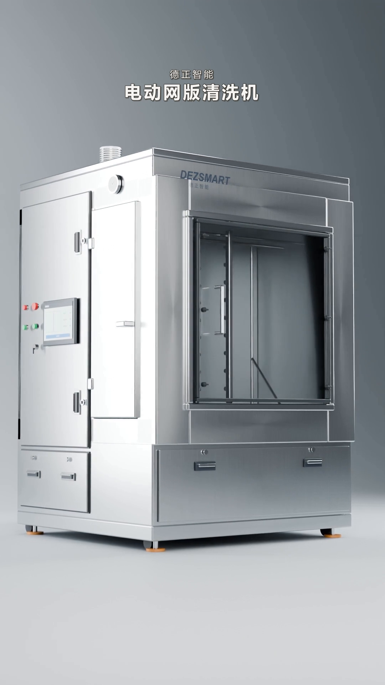
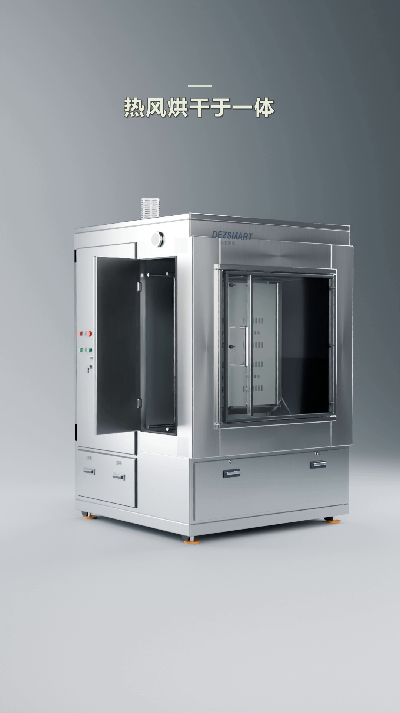
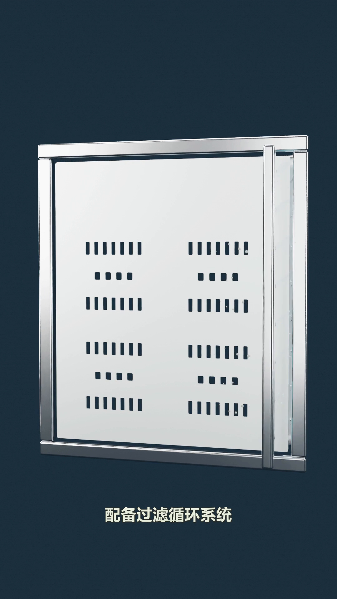
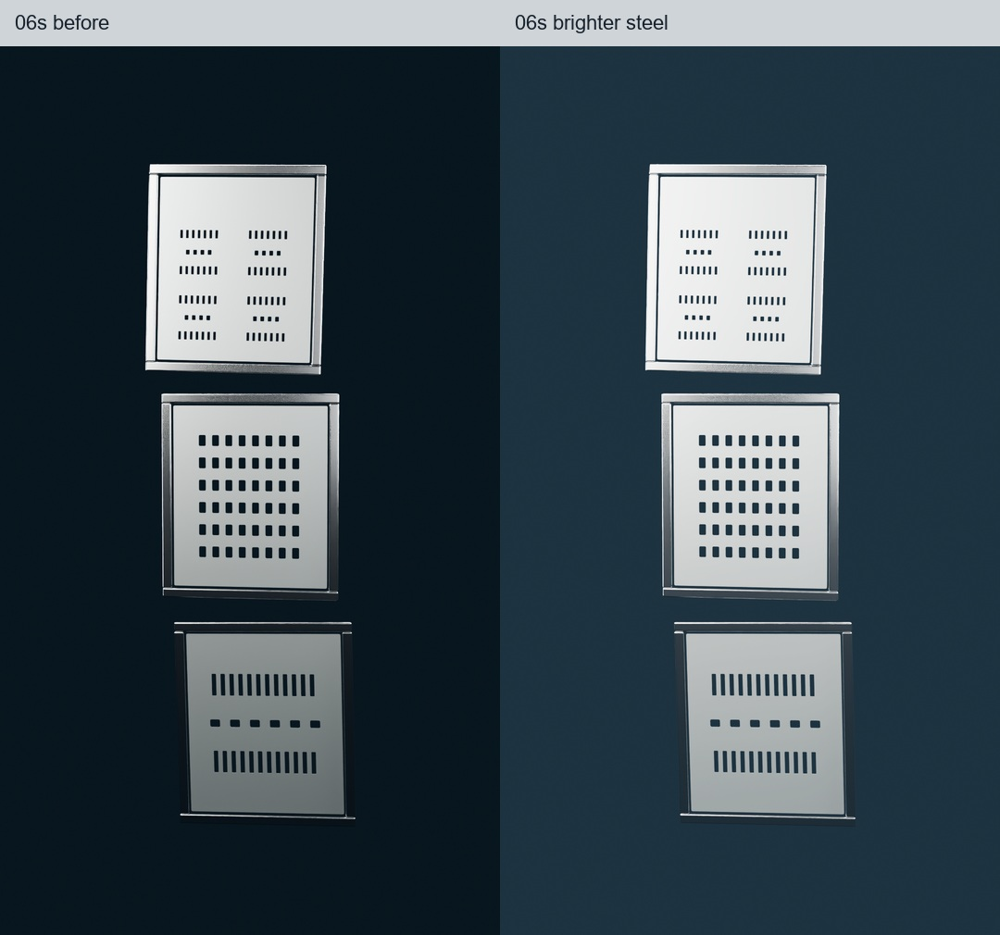

# B 端不锈钢设备展示宣传片 Skill

把一次做满意的设备宣传片，变成下一次可以继续沿用的制作方法。

`b2b-stainless-equipment-video` 面向不同品牌的不锈钢工业设备，帮助代理把设备照片、视频或已有工程组织成适合采购人员、技术人员观看的产品宣传片，也支持继续修改已认可的版本。

展示重点是让观众看清整机外观、关键结构与工艺细节，理解设备用途和已确认的功能。参数、适配范围与效果以当前机型资料为准，品牌名称、标识和产品信息随项目设置。

**默认风格：竖屏展示、真实比例、低机位、平稳运镜、清楚的金属细节，以及克制的文字标识。**

## 已认可的效果

以下图片来自已完成的**德正智能电动网版清洗机案例**。德正智能是这组示例的产品品牌；技能本身适用于不同品牌，不会把案例品牌自动写入新项目。

<p align="center">
  
  
  
</p>

<p align="center">整机展示 · 功能文字标识 · 清洗细节与配音字幕</p>

画面较暗时，针对相应镜头调整暗部和中间亮度，保留网孔与金属表面的对比。



> 示例中的漂洗、烘干、过滤循环等功能来自该机型的用户说明。制作其他设备视频时，需要使用对应机型的资料，不能把示例功能直接套用到新产品。

## 适合怎样使用

| 任务 | 这个 Skill 帮助代理做什么 |
| --- | --- |
| 给另一台机器做宣传片 | 根据实际外观和用途组织整机、适用对象、操作过程、细节和收尾镜头 |
| 面向采购与技术人员介绍设备 | 清楚展示整机、结构与工艺细节、用途及已确认功能；参数和效果使用项目提供的依据 |
| 继续修改已有版本 | 先确定用户认可的版本，再修改指定片段，保留原文件和修改记录 |
| 增加配音和字幕 | 优先复用已认可的声音，用实际音频时间安排字幕和功能重点 |
| 调整暗部、反光或字幕位置 | 优先进行局部后期处理，检查网孔、关键机构和产品轮廓是否清楚 |
| 输出不同用途的版本 | 明确字幕、解说和音乐各自是否保留，避免把“纯画面”误做成完全静音 |

它是一套供代理使用的制作指导与检查工具。实际工作还需要设备素材、可用的剪辑或三维环境，以及项目所需的配音服务；仓库没有打包三维模型、原始素材或生成服务。

## 保留下来的风格

- **产品比例优先。** 机身、侧门、窗口、喷嘴等结构以当前机型参考为准；不锈钢效果只用于实际金属部件。
- **产品站得住。** 优先略低的正侧面机位，保留完整轮廓；默认不使用底部圆台和蓝色圆环。
- **运动平稳。** 运镜有明确的起止，检查模型接缝、共面重叠和逐帧变化造成的闪烁。
- **金属有层次。** 高光保持细节，暗部能够看清；按镜头调整，不让整片一起变白。
- **文字有重点。** 白色与浅青色是本案例的风格参考，可按当前品牌调整；一次强调一个意思，避开网孔和关键机构。用户选择文字介绍功能时，可以直接用标识表达。
- **声音可延续。** 优先复用当前项目已认可的声音；Guoliang 中文男声仅作为本案例参考，实际选择以品牌调性、用户要求和服务可用性为准。

默认输出为 **9:16、1080×1920、30fps**。时长、镜头数量、转动角度和产品结构按项目决定，示例中的 43 秒不作为固定模板。

## 安装

下载或克隆本仓库，将仓库文件放入个人技能目录：

| 系统 | 目标目录 |
| --- | --- |
| Windows | `%USERPROFILE%\.codex\skills\b2b-stainless-equipment-video` |
| macOS / Linux | `~/.codex/skills/b2b-stainless-equipment-video` |

如果已经设置 `CODEX_HOME`，使用该目录下的 `skills/b2b-stainless-equipment-video`。确认目标目录中直接存在 `SKILL.md`，避免多套一层同名文件夹。然后在支持 Skill 的代理中调用 `$b2b-stainless-equipment-video`。

## 这样开始

**给新设备做一条片子**

```text
用 $b2b-stainless-equipment-video 给这台不锈钢设备做一条竖屏宣传片。
观众是采购和技术人员，请参考我提供的正面、侧面和运行素材，
展示整机、关键结构、用途和已确认功能，使用本项目的品牌信息。
先检查素材与机型资料，再完成脚本、镜头和导出。
```

**修改已有成片**

```text
用 $b2b-stainless-equipment-video 继续修改这个已认可的版本。
把 6 秒和 24 秒附近的钢网展示提亮，保留金属细节。
增加简洁的中文解说与同步字幕，沿用之前认可的声音。
```

**另出一个干净版本**

```text
用 $b2b-stainless-equipment-video 导出这版的纯画面版本：
去掉新增字幕和解说，保留背景音乐、现有镜头和提亮效果。
```

“无字幕配音”这类说法可能指两种版本。说明字幕、配音和音乐分别要不要保留，能让结果更准确。

## 工具怎样选择

| 项目需要 | 常见选择 |
| --- | --- |
| 写实材质、真实三维角度变化 | Blender，或继续复用已有的 Three.js / GSAP 工程 |
| 文字、节奏、图层和整体编排 | Remotion、已有合成工程或其他合适的工具 |
| 局部调色、配音混音、字幕与版本导出 | Python、FFmpeg 及当前可用的编辑工具 |

优先利用已有工程和可用能力。换成 Remotion 本身不会让模型或材质自动变得更真实，也不预设必须购买 Seedance 或使用某个配音平台。

## 仓库内容

| 路径 | 用途 |
| --- | --- |
| [SKILL.md](SKILL.md) | 技能入口、工作方式与关键约束 |
| `references/` | 按需读取的风格、案例和制作参考 |
| `agents/openai.yaml` | 技能名称、描述和示例调用 |
| [scripts/check_video.py](scripts/check_video.py) | 检查导出参数，可选执行完整解码 |
| `docs/images/` | README 中使用的已认可效果图 |

### 检查一次导出

环境中需要 Python 以及可执行的 `ffprobe`、`ffmpeg`。例如，检查一条预期为 43 秒的竖屏成片：

```bash
python scripts/check_video.py "output.mp4" --report "video-check.json" --expect-width 1080 --expect-height 1920 --expect-fps 30 --expect-duration 43 --decode
```

实际项目时长不同时，修改或省略 `--expect-duration`。完整解码可发现文件损坏等问题；参数检查不能代替对画面、字幕和声音的审阅。

## 使用边界

新机型的外观与功能需要重新依据资料确认。容量、尺寸、节拍、耗能、适配材料和清洁效果等信息应来自对应机型的资料或用户确认，不为增强宣传效果编造参数、认证或性能。宣传文案采用可核实的表述，避免把动画演示当成实测效果，或无依据地承诺“全部冲干净”“绝不伤网版”。

配音保留原始音频、正确术语和真实时间映射，重导出时复用已经生成的音频。自动语音识别可以帮助核对内容，但不能证明声音听感或发音完全正确；没有完成的审阅应如实说明。

示例图片用于说明本技能的风格。用于其他品牌或产品时，请替换为自己有权使用的素材，并保留相应产品的真实外观与信息。
